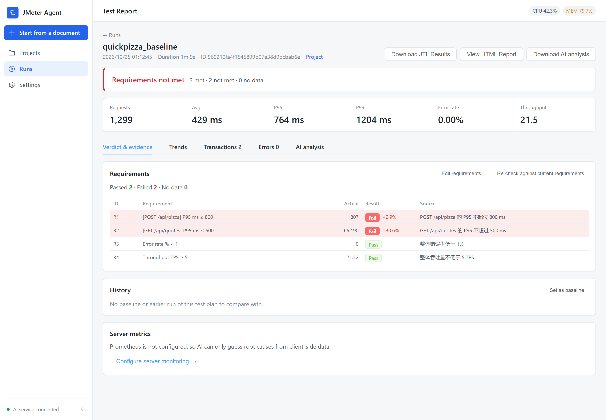
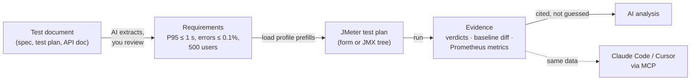
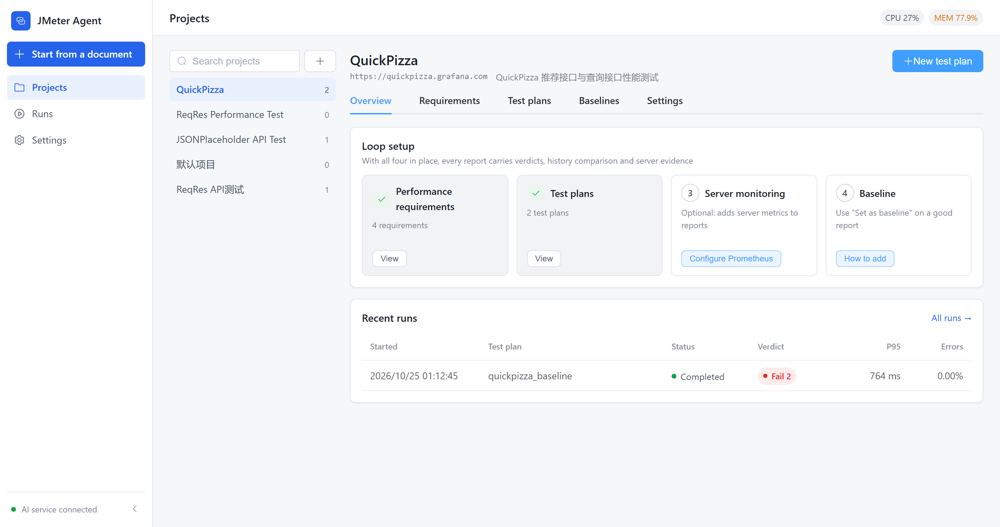
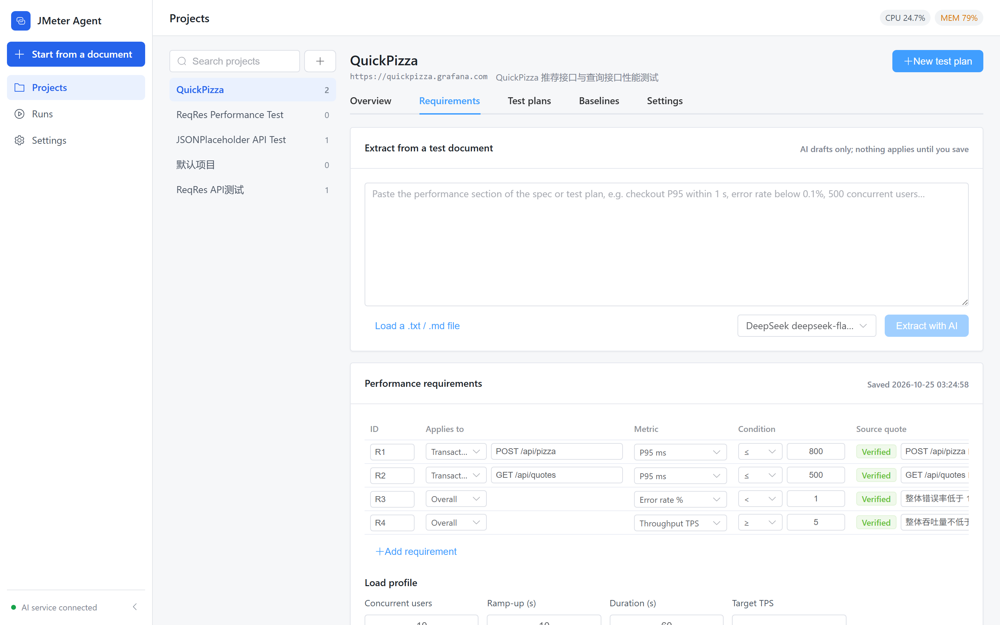
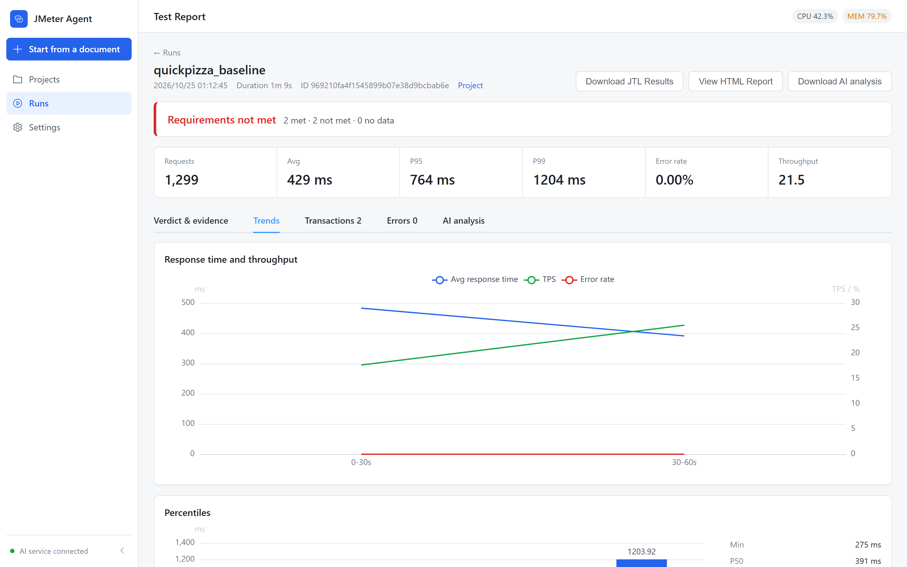
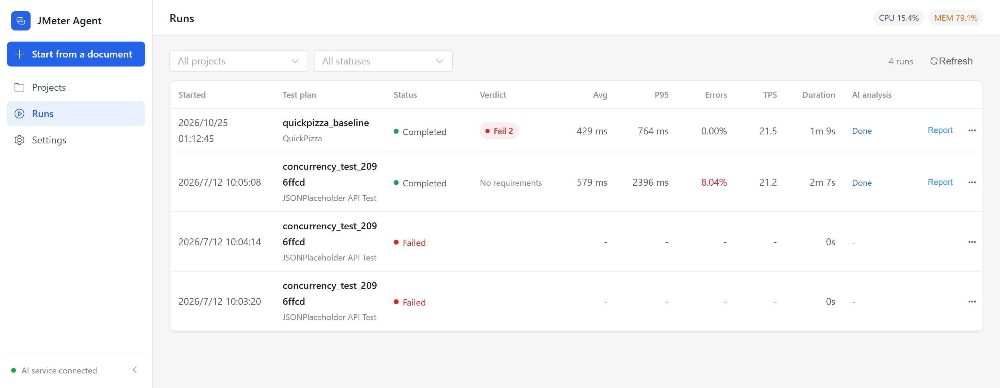

<div align="center">

# JMeter Agent

**Turn a performance test document into a pass / fail verdict you can defend.**

A local AI agent for Apache JMeter: it reads your requirements, builds the test plan, runs it,<br>
and judges every run against the numbers you actually agreed on — with the evidence attached.

**English** · [简体中文](README.zh-CN.md)

[](LICENSE)




</div>

## Why

Most "AI for load testing" tools stop at *"the P95 looks high, consider adding a cache."*
That is not something you can sign off on. What you need after a run is:

- **Did we meet the requirements?** Each one, with the measured value and how far off it is.
- **Did it get worse?** Compared with the baseline and the previous run, overall and per transaction.
- **Why?** Server-side metrics for the exact test window, not guesses from client latency.

JMeter Agent produces those answers deterministically, then lets the AI explain them — and the AI must cite
requirement IDs and measured values. Anything it cannot back up is labelled as a hypothesis, with a way to check it.

## How it works



1. **Document → requirements.** Paste a spec or upload a file. AI drafts quantified requirements (P90/P95/P99, average, max, error rate, TPS) plus the load profile. Every item quotes its source sentence, and quotes that cannot be found in the document are flagged for review. Nothing is saved until you confirm.
2. **Requirements → test plan.** New plans start from the documented concurrency, ramp-up and duration. Edit them in a form view or the full JMX tree.
3. **Run → evidence.** Each run is judged requirement by requirement (transaction-level requirements use the worst matching sampler), compared with the active baseline and the previous run, and enriched with Prometheus metrics for the run window: saturation time and correlation with response time.
4. **Evidence → analysis.** The AI analysis receives the same evidence and must ground its conclusions in it.

## Features

| | |
|---|---|
| **Requirement verdicts** | Overall and per-transaction requirements, a verdict banner on every report, gap percentages for failures, verified source quotes. |
| **Start from a document** | One wizard for a requirements/API document or an OpenAPI URL; produces the project, test plans and a requirements draft. |
| **Baselines that stay put** | One click on a report sets it as the baseline. The baseline keeps a metrics snapshot, so deleting old runs does not break comparisons. |
| **Server-side evidence** | Prometheus presets for host (node_exporter), JVM + HikariCP and MySQL; collected per run window and cached. |
| **Honest AI analysis** | Fact sheet, number validation, hypothesis ledger and a RAG knowledge base of past runs. DeepSeek, OpenAI, Claude, Qwen or any OpenAI-compatible endpoint. |
| **MCP built in** | Streamable HTTP endpoint with evidence tools (`get_execution_evidence`, `extract_performance_requirements`, `promote_execution_to_baseline`, …). Writes need your confirmation in the UI. |
| **Solid JMeter plumbing** | Streaming JTL parser with exact percentiles and flat memory use, queued runs when the load generator is busy, live progress over WebSocket, SelfHeal for broken extractors. |
| **Private by default** | No accounts and no login; the server refuses to bind to anything but loopback, and Host/Origin checks block other sites in your browser. |

## Screenshots

<table>
  <tr>
    <td width="50%"><br><sub><b>Project overview</b> — what is set up, and the latest verdicts</sub></td>
    <td width="50%"><br><sub><b>Requirements</b> — AI draft, source quotes, load profile</sub></td>
  </tr>
  <tr>
    <td width="50%"><br><sub><b>Trends</b> — response time, throughput, errors, percentiles</sub></td>
    <td width="50%"><br><sub><b>Runs</b> — every run, its verdict and key numbers at a glance</sub></td>
  </tr>
</table>

<sub>Screenshots come from a sample run against the public JSONPlaceholder API, with four example requirements.</sub>

## Quick start

**Requirements:** Python 3.11+, Node.js 20+, Java 11+ and [Apache JMeter 5.6.3](https://jmeter.apache.org/download_jmeter.cgi). Tested on Windows and Linux; macOS should work but is untested.

```bash
git clone https://github.com/xiaoyuCR7/jmeter-ai-agent.git
cd jmeter-ai-agent
```

**1. Make JMeter discoverable** — pick one:

- extract the archive's `bin/` and `lib/` into the project root (zero configuration), or
- set `JMETER_HOME` to JMeter's `bin` directory (or its install root), or
- put JMeter's `bin` on your `PATH`.

JMeter is only needed to execute load tests; editing plans and running the unit tests work without it.

**2. Start everything**

```bash
./start.sh        # Linux / macOS
start.bat         # Windows
```

Or by hand:

```bash
cd jmeter-agent-backend && pip install -r requirements.txt && python -m app.main   # http://127.0.0.1:8000
cd jmeter-agent-frontend && npm install && npm run dev                             # http://localhost:3000
```

**3. Add a model** in **Settings → AI models**: pick DeepSeek, Qwen, OpenAI, Claude or any OpenAI-compatible endpoint and paste
an API key. Leave **Context window** empty and the app asks the provider for the model's real size (DeepSeek and Claude report
it; documented sizes cover the rest). Then click **Start from a document**.

API docs are served at http://127.0.0.1:8000/api/docs.

## Use it from Claude Code, Cursor and friends

```bash
claude mcp add --transport http jmeter-agent http://127.0.0.1:8000/api/v1/mcp
```

Ready-to-copy configs for Cursor, VS Code and others are under **Settings → Assistants (MCP)**. Ask the assistant to use the
`analyze-execution` prompt, or to call `get_execution_evidence` first — it gets exactly what the report page shows.
Older SSE-only clients can use `/api/v1/mcp/sse`.

## Configuration

Common settings in `jmeter-agent-backend/.env`:

| Variable | Purpose | Default |
|---|---|---|
| `PORT` | Backend port | `8000` |
| `JMETER_HOME` | JMeter `bin` directory or install root | `<project>/bin` |
| `JMETER_TIMEOUT` | Max run time in seconds | `3600` |
| `JMETER_HEAP_MIN` / `JMETER_HEAP_MAX` | JMeter JVM heap | `256m` / `2g` |
| `JMETER_EXECUTION_MODE` | `local` or `container`; see Execution isolation below | `local` |
| `JMETER_MAX_OUTPUT_MB` | Stop a run whose report directory grows past this; `0` = no limit | `10240` |
| `RESOURCE_CPU_THRESHOLD` / `RESOURCE_MEMORY_THRESHOLD` | Queue new runs above this load-generator usage (%) | `80` / `85` |
| `DEFAULT_AI_MODEL` | Model ID used when a request names none | first enabled model |
| `AGENT_CONTEXT_TOKEN_BUDGET` | Token budget for a model whose context window is unknown | `16384` |

Model API keys are not read from `.env`; add models in the UI. They are stored in `jmeter-agent-backend/ai_models_config.json`,
which git ignores.

`HOST` must stay a loopback address: there is no login, so the server refuses to start on anything else.

### Execution isolation

JMeter plans can run code: JSR223 / BeanShell elements, the OS Process Sampler, and functions such as `${__groovy()}`.
`JMETER_EXECUTION_MODE` decides where that code runs.

| Mode | How JMeter runs | Use it for |
|---|---|---|
| `local` (default) | A child process with your privileges. Before running a plan that contains scripts, commands or an Include Controller, the app lists them and asks you (the agent asks a second time, separately). Plans the app generates contain none. | Plans you wrote or generated here |
| `container` | Docker: read-only root filesystem, all capabilities dropped, no privilege escalation, non-root user, memory / CPU / process limits, no shared IPC, only the plan's project folder mounted (read-only) | Plans from anywhere else |

Container mode needs Docker and `JMETER_CONTAINER_IMAGE`, a locally available image pinned by `@sha256:` digest (it is
never pulled automatically). Containers can reach the network so they can generate load; to stop them reaching your
LAN or cloud metadata endpoints, create a Docker network with restricted egress and set `JMETER_CONTAINER_NETWORK`.
Every run container is labelled `jmeter-agent`, and the backend removes any left running when it starts.

In both modes a run stops when its report directory exceeds `JMETER_MAX_OUTPUT_MB` (default 10240), and JMeter
never sees the backend's environment variables (model keys, database settings).

### Webhook

Set `WEBHOOK_URL` to receive a POST for every run, however it was started (UI, agent, scheduler, MCP):

| Event | When | Switch |
|---|---|---|
| `test.started` | JMeter is launching | `WEBHOOK_ON_START` |
| `test.completed` / `test.failed` / `test.cancelled` | The run ended; sent before AI analysis | `WEBHOOK_ON_COMPLETE` / `WEBHOOK_ON_FAILURE` (both failure kinds) |
| `analysis.completed` | Post-run AI analysis finished or failed | `WEBHOOK_ON_ANALYSIS` |

The JSON body carries the execution, project and plan IDs, plan name, status, duration, key metrics, the requirements
verdict and any error. Errors are cut to their first line with local paths reduced to file names. `analysis.completed`
sends the analysis status and conclusion; set `WEBHOOK_INCLUDE_ANALYSIS=true` to also send the full assessment, which
may quote your endpoints.

Use an `https` URL and set `WEBHOOK_SECRET`; the server logs a warning at startup otherwise. A receiver should:

1. Compute HMAC-SHA256 with the secret over `<X-JMeter-Agent-Timestamp>.<raw body>` and compare `sha256=<hex>`
   with `X-JMeter-Agent-Signature` in constant time (e.g. Python `hmac.compare_digest`).
2. Reject requests whose `X-JMeter-Agent-Timestamp` (Unix seconds) is more than 5 minutes old.
3. Drop `X-JMeter-Agent-Delivery` IDs it has already seen; the ID stays the same across retries.

Only 2xx counts as delivered. Network errors, 408, 429 and 5xx are retried 3 times (after 1 s, 5 s, 15 s); redirects
and other 4xx are not, so point `WEBHOOK_URL` at the final address. Logs name only the receiver's host, never the URL,
because webhook URLs often contain a token.

<details>
<summary><b>Key API endpoints</b></summary>

| Method | Path | Description |
|---|---|---|
| GET / PUT | `/api/v1/projects/{id}/requirements` | Read / save performance requirements |
| POST | `/api/v1/projects/{id}/requirements/extract` | AI requirements draft from document text |
| GET / PUT | `/api/v1/projects/{id}/monitoring` | Prometheus configuration |
| POST | `/api/v1/test-plans/{id}/execute` | Run a test plan |
| GET | `/api/v1/executions` | Runs with verdicts and key metrics |
| GET | `/api/v1/executions/{id}/report` | Full report |
| GET | `/api/v1/executions/{id}/evidence` | Verdicts, history comparison, server metrics |
| POST | `/api/v1/executions/{id}/promote-baseline` | Set a run as the baseline |
| POST | `/api/v1/mcp` | MCP Streamable HTTP endpoint |

</details>

<details>
<summary><b>Project layout</b></summary>

```
jmeter-ai-agent/
├── jmeter-agent-backend/     FastAPI service
│   └── app/
│       ├── api/              REST + MCP routes
│       ├── services/
│       │   ├── requirements.py, evidence.py, baseline_compare.py, server_metrics.py
│       │   ├── ai/           model adapters, agents, RAG
│       │   └── jmeter/       executor, JMX builder/parser, streaming JTL parser
│       └── middleware/       loopback Host / Origin guard
├── jmeter-agent-frontend/    Vue 3 + TypeScript + Element Plus
└── start.sh / start.bat
```

`bin/`, `lib/` (the JMeter runtime), test plans, reports and local databases are git-ignored.

</details>

<details>
<summary><b>Troubleshooting</b></summary>

- **`JMeter executable not found`** — check `java -version`, then one of: `bin/jmeter(.bat)` in the project root, `JMETER_HOME`, or JMeter on `PATH` (`jmeter --version`).
- **AI analysis fails** — test the model in **Settings → AI models**; check the key and network access.
- **"exceeds the context budget"** — the model's context window is unknown, so the conservative `AGENT_CONTEXT_TOKEN_BUDGET`
  applies. Edit the model and enter its context window (in tokens).
- **Port in use** — `PORT=8001 ./start.sh` (Windows: `set PORT=8001` then `start.bat`).
- **Runs stay queued** — the load generator is above `RESOURCE_*_THRESHOLD`; the top bar shows its CPU / memory.
- **Logs** — `jmeter-agent-backend/server_stdout.log`, `server_stderr.log`, and `reports/{execution_id}/jmeter.log` per run.

</details>

## Development

```bash
cd jmeter-agent-backend && pip install -r requirements-dev.txt && pytest tests
cd jmeter-agent-frontend && npm install && npm run test:run && npx vue-tsc --noEmit
cd jmeter-agent-frontend && npx playwright install chromium && npm run test:e2e   # browser smoke test (mocked API); add PW_CHANNEL=chrome to reuse a local Chrome
```

Issues and pull requests are welcome. Please keep PRs focused and include tests for behaviour changes.

## License

[Apache License 2.0](LICENSE). Apache JMeter is a trademark of the Apache Software Foundation; this project is not affiliated with or endorsed by it.
