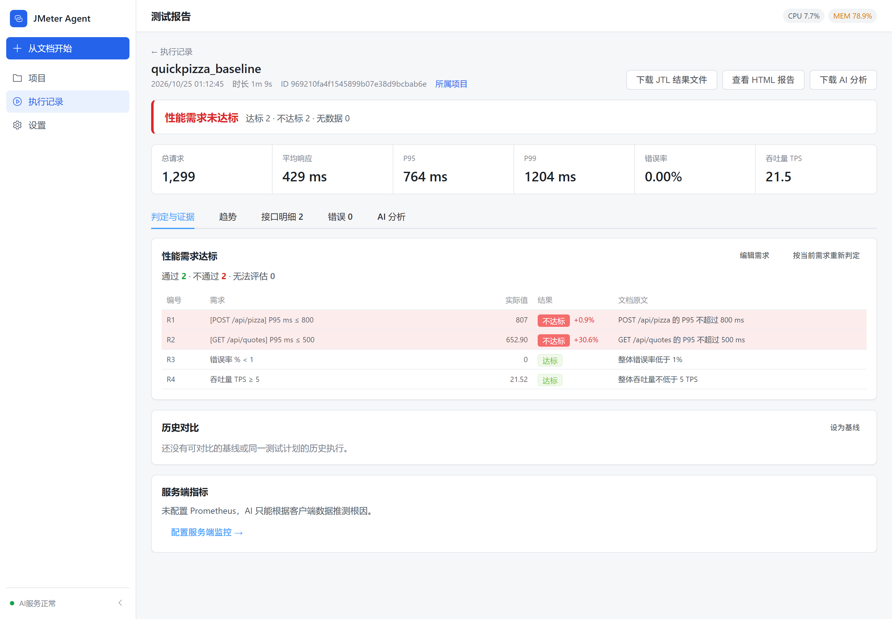
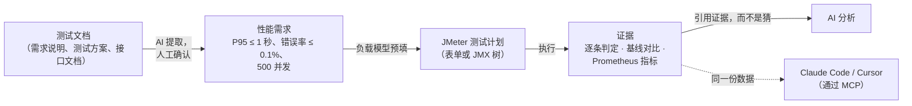
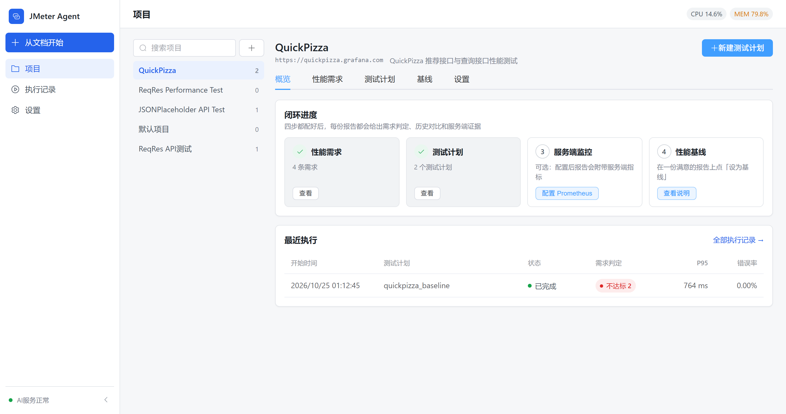
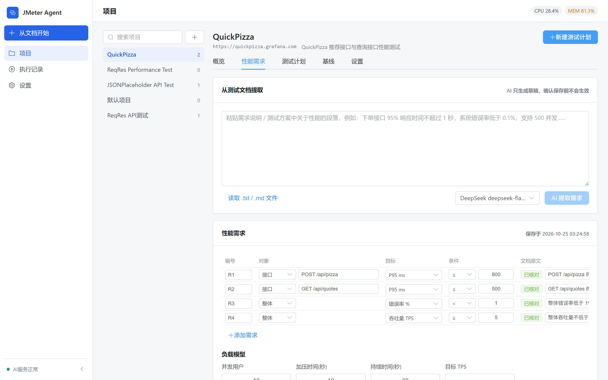
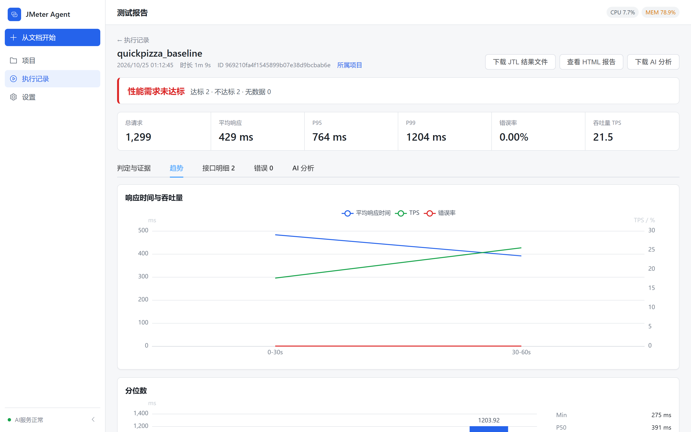
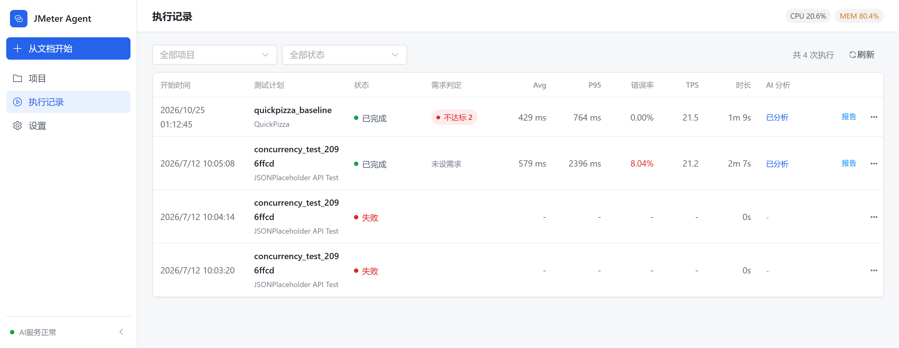

<div align="center">

# JMeter Agent

**把性能测试文档，变成一份站得住的达标 / 不达标结论。**

面向 Apache JMeter 的本地 AI 智能体：读懂你的性能需求，生成测试计划，执行压测，<br>
再拿每次结果逐条对照当初约定的指标下结论，并附上证据。

[English](README.md) · **简体中文**

[](LICENSE)




</div>

## 为什么做这个

大多数「AI + 压测」工具的分析停留在「P95 有点高，建议加缓存」，这样的结论没法拿去验收。压测结束后真正需要回答的是：

- **需求达标了吗？** 每一条都要有实际值，以及超出多少。
- **性能变差了吗？** 和基线、和上一次执行比，整体和接口级都要看。
- **为什么？** 要看测试时间窗内的服务端指标，而不是只凭客户端响应时间去猜。

JMeter Agent 先用确定性的方式算出这些答案，再让 AI 解释；AI 必须引用需求编号和实际数值，拿不出证据的地方会标成【假设】，并给出验证方法。

## 工作方式



1. **文档 → 需求**：粘贴或上传文档，AI 生成可量化的需求草稿（P90/P95/P99、平均、最大、错误率、TPS）和负载模型。每条需求都附带文档原文，原文在文档里找不到的会标出来待核对；确认之前不会保存。
2. **需求 → 测试计划**：新建计划时按文档里的并发、加压时间和时长预填，可以在表单视图或完整的 JMX 树里编辑。
3. **执行 → 证据**：每次执行逐条判定需求（接口级需求取匹配到的最差接口），自动和当前基线、上一次执行对比，并采集测试时间窗内的 Prometheus 指标，算出饱和时间占比和与响应时间的相关系数。
4. **证据 → 分析**：AI 分析拿到的是同一份证据，结论必须以它为依据。

## 功能

| | |
|---|---|
| **需求判定** | 支持整体和接口级需求；每份报告顶部给出判定，不达标的标出超出比例，文档原文自动核对。 |
| **从文档开始** | 一个向导接收需求 / 接口文档或 OpenAPI 地址，生成项目、测试计划和需求草稿。 |
| **稳定的基线** | 在报告上一键「设为基线」；基线保存指标快照，删掉旧执行也不影响对比。 |
| **服务端证据** | 内置主机（node_exporter）、JVM + HikariCP、MySQL 的 Prometheus 指标预设，按测试时间窗采集并缓存。 |
| **可信的 AI 分析** | 事实表和数字校验：每个数字按它说的是哪个接口、还是整体去核对，中英文报告都会核对。报告会对比同一计划的历史运行、不同负载和其它计划里的相同接口，自动验证之前的预测，并引用团队保存的经验。报告语言跟随界面，也可以用 `REPORT_LANGUAGE` 固定。 |
| **主流模型都能用** | 内置 25 家服务商预设：OpenAI、Claude、Gemini、Azure OpenAI、xAI Grok、Mistral、Cohere、Groq、OpenRouter、Together，DeepSeek、通义千问、Kimi、智谱 GLM、豆包、文心、混元、MiniMax、阶跃星辰、硅基流动，以及本地的 Ollama、LM Studio、vLLM 和任意 OpenAI / Anthropic 兼容接口。推理模型要求的参数差异由程序自动适配。 |
| **验证与容量探索** | 报告里能被程序验证的假设可以一键「运行验证」，程序会按预测里写的负载重跑，跑完自动判定。「容量探索」从起始线程数开始逐级加压，在第一个需求不达标、错误率超限或吞吐量不再增长的负载处停下，给出这个计划能承受的负载。 |
| **实时运行面板** | 运行中的测试在执行记录页顶部显示卡片，点开能看到每 5 秒更新的吞吐量、响应时间、错误率和线程曲线，错误最多的接口，按计划时长算出的真实进度和剩余时间，也能直接停止。 |
| **运行守护与 CI 门禁** | 运行中最近 30 秒的请求几乎全部失败时，程序自动停止这次运行并写明原因。`scripts/ci_gate.py` 运行计划并按门禁结果返回退出码：需求不达标或相对基线退化时失败。 |
| **内置 MCP** | Streamable HTTP 端点，提供 `get_execution_evidence`、`extract_performance_requirements`、`promote_execution_to_baseline` 等证据工具；写操作需要在界面上确认。 |
| **扎实的 JMeter 底座** | 流式 JTL 解析（精确分位数、内存不随样本数增长）、压测机繁忙时自动排队、WebSocket 实时进度；单用户试跑会列出每个请求的响应，并给出经响应核对过的提取规则修改。 |
| **默认私有** | 没有账号和登录；服务只允许监听本机回环地址，并校验 Host / Origin，防止浏览器里的其它网站调用本地接口。 |

## 界面截图

<table>
  <tr>
    <td width="50%"><br><sub><b>项目概览</b>：配置进度和最近的判定结果</sub></td>
    <td width="50%"><br><sub><b>性能需求</b>：AI 草稿、原文核对、负载模型</sub></td>
  </tr>
  <tr>
    <td width="50%"><br><sub><b>趋势</b>：响应时间、吞吐量、错误率与分位数</sub></td>
    <td width="50%"><br><sub><b>执行记录</b>：每次执行的判定和关键数字一目了然</sub></td>
  </tr>
</table>

<sub>截图来自对公开的 JSONPlaceholder API 的一次示例压测，配了 4 条示例需求。</sub>

## 快速开始

**环境要求**：Python 3.11+、Node.js 20+、Java 11+，以及 [Apache JMeter 5.6.3](https://jmeter.apache.org/download_jmeter.cgi)。已在 Windows 和 Linux 上测试；macOS 理论上可用，但尚未测试。

```bash
git clone https://github.com/xiaoyuCR7/jmeter-ai-agent.git
cd jmeter-ai-agent
```

**1. 让程序找到 JMeter**（任选一种）：

- 把压缩包里的 `bin/` 和 `lib/` 解压到项目根目录（无需配置）；
- 设置 `JMETER_HOME` 指向 JMeter 的 `bin` 目录（或安装根目录）；
- 把 JMeter 的 `bin` 加入 `PATH`。

只有执行压测时才需要 JMeter，编辑测试计划和跑单元测试都不需要。

**2. 启动**

```bash
./start.sh        # Linux / macOS
start.bat         # Windows
```

启动脚本会通过带有本地访问令牌的链接打开应用。只有第一次访问需要它，之后浏览器会保存 Cookie。这不是登录，详见[本地访问](#本地访问)。

Windows 上还有两个脚本：`stop.bat` 关闭 `start.bat` 打开的后端和前端（端口被别的程序占用时不会动它）；`create-shortcut.bat` 在桌面建一个带图标的「JMeter Agent」快捷方式，双击就能启动。

或手动启动：

```bash
cd jmeter-agent-backend && pip install -r requirements.txt && python -m app.main   # http://127.0.0.1:8000
cd jmeter-agent-frontend && npm install && npm run dev                             # 打开后端打印的链接
```

**3. 添加模型**：在「设置 → AI 模型配置」里选择服务商（国内、海外、本地三组共 25 家），填入 API Key。Ollama、LM Studio 等本机服务不需要 Key；Azure OpenAI 需要填资源地址和 API 版本，模型名填部署名。
「上下文窗口」留空即可，保存时会向服务商查询这个模型的真实大小，查不到时用官方公布值。
然后点左上角「从文档开始」。

接口文档地址：http://127.0.0.1:8000/api/docs

## 在 Claude Code、Cursor 等助手里使用

```bash
claude mcp add --transport http jmeter-agent http://127.0.0.1:8000/api/v1/mcp --header "Authorization: Bearer <令牌>"
```

令牌就是访问链接里的那一段，也保存在 `jmeter-agent-backend/.local_access_token`。Cursor、VS Code 等客户端的配置可以在「设置 → 外部助手接入（MCP）」里一键复制，已经带好令牌。分析时让助手使用 `analyze-execution` 提示词，或先调用 `get_execution_evidence`，它拿到的数据和报告页完全一致。只支持 SSE 的旧客户端可以用 `/api/v1/mcp/sse`。

通过 MCP 调用时，`execute_test` 和 `execute_distributed` 在执行启动后立即返回，客户端的请求超时不会中止压测，结果用 `get_execution_status` 查询。
会修改或运行内容的工具最多等待两分钟，由你在 JMeter Agent 窗口里批准，请保持窗口打开。客户端在此之前取消或断开，这次请求和待确认项都会撤销。

## 接入 CI

在运行 JMeter Agent 的机器上（自托管 runner）执行：

```bash
python jmeter-agent-backend/scripts/ci_gate.py --plan <测试计划ID>
```

脚本会启动这个计划，轮询 `GET /api/v1/executions/{id}/gate`，然后按结果退出：需求和基线都通过时退出码为 `0`；需求不达标或相对基线退化时为 `1`；运行没有完成或等待超时为 `2`。令牌按 `--token`、环境变量 `JMETER_AGENT_TOKEN`、`.local_access_token` 文件的顺序读取。如果计划里含脚本，第一次会被拒绝，并打印出需要批准的 `sha256`，确认可信后用 `--approved-sha256` 传入。

## 评估 AI 报告

`tests/golden/report_claims.json` 是一组人工标注的报告句子，每句都注明其中的数字对不对。测试会检查数字核对器能否抓出每个错数字，同时不误报正确的数字。要看某个模型写的报告质量，运行：

```bash
cd jmeter-agent-backend
python scripts/eval_reports.py --list-models
python scripts/eval_reports.py --model <模型ID> [--lang en] [--repeat 3]
```

模型会为每个标注运行写一份报告，然后统计核对了多少个数字、改写前后各错了几个、有没有空着的章节、语言是否正确。结果保存在 `eval_results/`，并和这个模型上一次的结果对比，改完提示词或换了模型后，就能用数字判断是变好还是变差。这一步会调用模型，消耗 token。

## 配置

`jmeter-agent-backend/.env` 中的常用配置：

| 变量 | 作用 | 默认值 |
|---|---|---|
| `PORT` | 后端端口 | `8000` |
| `JMETER_HOME` | JMeter 的 `bin` 目录或安装根目录 | `<项目>/bin` |
| `JMETER_TIMEOUT` | 单次执行最长时间（秒） | `3600` |
| `AUTO_ANALYSIS_ENABLED` | 每次运行结束后写 AI 报告，不论运行由谁发起；关闭后实测历史仍会保留 | `true` |
| `JMETER_HEAP_MIN` / `JMETER_HEAP_MAX` | JMeter JVM 堆内存 | `256m` / `2g` |
| `JMETER_EXECUTION_MODE` | `local` 或 `container`，见下方「执行隔离」 | `local` |
| `JMETER_MAX_OUTPUT_MB` | 报告目录超过这个大小（MB）时停止执行，`0` 表示不限制 | `10240` |
| `RESOURCE_CPU_THRESHOLD` / `RESOURCE_MEMORY_THRESHOLD` | 压测机占用超过该比例（%）时新执行排队 | `80` / `85` |
| `DEFAULT_AI_MODEL` | 请求没有指定模型时使用的模型 ID | 第一个启用的模型 |
| `AGENT_CONTEXT_TOKEN_BUDGET` | 上下文窗口未知的模型使用的 token 预算 | `16384` |
| `AGENT_MAX_CONCURRENT` | 同时运行的 AI 任务数；运行后自动写报告最多占用其中 N-1 个，给追问留一个 | `3` |
| `REPORT_LANGUAGE` | 运行后自动写报告用的语言，`zh-CN` 或 `en`；留空则用 `I18N_DEFAULT_LANG`。手动重写报告和追问跟随页面语言 | 空 |
| `RUN_GUARD_ENABLED` | 运行守护：最近的请求几乎全部失败时停止运行 | `true` |
| `RUN_GUARD_ERROR_RATE` / `RUN_GUARD_WINDOW_SECONDS` | 触发停止的错误率（%）和统计窗口（秒）；连续两次检查超限才停止 | `90` / `30` |
| `RUN_GUARD_MIN_SAMPLES` / `RUN_GUARD_GRACE_SECONDS` | 窗口内少于这么多请求不判断；运行开始后的这段时间不判断 | `50` / `30` |

模型的 API Key 不从 `.env` 读取，请在界面里添加。它们保存在 `jmeter-agent-backend/ai_models_config.json`，这个文件已被 git 忽略。

因为没有登录，`HOST` 只能是本机回环地址，设成其它地址服务会拒绝启动，来自其它机器的连接也会被拒绝。

### 本地访问

接口、实时推送和报告文件都需要本地访问令牌，否则本机任何能发 HTTP 的程序都能调用它们，包括测试计划自己的 HTTP 取样器。
后端首次启动时生成令牌，保存在 `jmeter-agent-backend/.local_access_token`（已被 git 忽略），并打印访问链接。
Cookie 丢了或换了浏览器，重新打开这个链接，或在应用提示时粘贴它即可。MCP 客户端和脚本使用 `Authorization: Bearer <令牌>`。
删除这个文件并重启可以更换令牌，之后所有浏览器和 MCP 客户端都要用新令牌。

报告内容来自被测系统，所以报告页运行在浏览器沙箱里。智能体工具分为 `read`、`draft`、`write`、`execute` 四级：后两级无论由本应用的智能体还是
MCP 客户端调用，都要等你确认；分析智能体只能使用 `read` 工具。

### 执行隔离

JMeter 计划能做的远不止发送压力：可以通过 JSR223 / BeanShell 组件、OS Process Sampler 和 `${__groovy()}` 这类函数运行代码，
也可以完全不用脚本，通过 `${__FileToString()}`、`${__StringToFile()}`、CSV 数据文件、HTTP 文件上传或监听器输出路径读写任意文件。
`JMETER_EXECUTION_MODE` 决定这些操作在哪里发生。

| 模式 | JMeter 怎么运行 | 适用场景 |
|---|---|---|
| `local`（默认） | 本机子进程，权限和你的账号相同。计划里有脚本、系统命令、Java 取样器、Include Controller、文件函数，或指向计划目录和应用数据目录之外的文件路径时，运行前会列出来请你确认（智能体发起的执行会单独再确认一次）。确认只对这份内容有效，计划改动后会重新询问。本应用生成的计划不含这些内容。 | 自己写的或在这里生成的计划 |
| `container` | Docker：根文件系统只读、去掉全部 Linux 权限、禁止提权、非 root 账号、限制内存 / CPU / 进程数、不共享 IPC，只读挂载计划所在的项目目录 | 来自其它地方的计划 |

容器模式需要 Docker，以及 `JMETER_CONTAINER_IMAGE`：一个本地已有、按 `@sha256:` 摘要锁定版本的镜像（不会自动拉取）。
容器需要联网才能施压；如果不想让它访问局域网或云服务器的元数据地址，请创建一个限制了出站访问的 Docker 网络，
并设置 `JMETER_CONTAINER_NETWORK`。每个执行容器都带有 `jmeter-agent` 标签，后端启动时会清理残留的容器。

两种模式下，报告目录超过 `JMETER_MAX_OUTPUT_MB`（默认 10240）时都会停止执行；JMeter 也拿不到后端的环境变量
（模型密钥、数据库配置等）。

### Webhook

设置 `WEBHOOK_URL` 后，每次执行都会向它 POST 事件，不论是从界面、智能体、调度器还是 MCP 发起的：

| 事件 | 时机 | 开关 |
|---|---|---|
| `test.started` | JMeter 正在启动 | `WEBHOOK_ON_START` |
| `test.completed` / `test.failed` / `test.cancelled` | 执行结束，在 AI 分析之前发送 | `WEBHOOK_ON_COMPLETE` / `WEBHOOK_ON_FAILURE`（同时管失败和取消） |
| `analysis.completed` | 执行后的 AI 分析完成或失败 | `WEBHOOK_ON_ANALYSIS` |

JSON 内容包括执行、项目、计划的 ID，计划名称，状态，时长，关键指标，需求判定结果和错误信息。错误信息只保留第一行，
本机路径只留文件名。`analysis.completed` 默认只发分析状态和结论；设置 `WEBHOOK_INCLUDE_ANALYSIS=true` 才会附上完整评估，
其中可能提到你的接口细节。

请使用 `https` 地址并设置 `WEBHOOK_SECRET`，否则服务启动时会记一条警告。接收方应当：

1. 用密钥对 `<X-JMeter-Agent-Timestamp>.<请求原始内容>` 计算 HMAC-SHA256，与 `X-JMeter-Agent-Signature` 中的
   `sha256=<十六进制>` 做常量时间比较（例如 Python 的 `hmac.compare_digest`）。
2. 拒绝 `X-JMeter-Agent-Timestamp`（Unix 秒）超过 5 分钟的请求。
3. 丢弃已经处理过的 `X-JMeter-Agent-Delivery` 投递 ID，重试时这个 ID 不变。

只有 2xx 算发送成功。网络错误、408、429 和 5xx 会重试 3 次（间隔 1 秒、5 秒、15 秒）；跳转和其它 4xx 不重试，
所以 `WEBHOOK_URL` 要填最终地址。日志里只记录接收方的主机名，不记录完整地址，因为 Webhook 地址里常带有 token。

<details>
<summary><b>主要接口</b></summary>

| 方法 | 路径 | 说明 |
|---|---|---|
| GET / PUT | `/api/v1/projects/{id}/requirements` | 读取 / 保存性能需求 |
| POST | `/api/v1/projects/{id}/requirements/extract` | 从文档文本生成需求草稿 |
| GET / PUT | `/api/v1/projects/{id}/monitoring` | Prometheus 配置 |
| POST | `/api/v1/test-plans/{id}/execute` | 执行测试计划 |
| GET | `/api/v1/executions` | 执行列表（含判定和关键指标） |
| GET | `/api/v1/executions/{id}/report` | 完整报告 |
| GET | `/api/v1/executions/{id}/evidence` | 需求判定、历史对比、服务端指标 |
| POST | `/api/v1/executions/{id}/promote-baseline` | 设为基线 |
| POST | `/api/v1/mcp` | MCP Streamable HTTP 端点 |

</details>

<details>
<summary><b>目录结构</b></summary>

```
jmeter-ai-agent/
├── jmeter-agent-backend/     FastAPI 服务
│   └── app/
│       ├── api/              REST 与 MCP 路由
│       ├── services/
│       │   ├── requirements.py、evidence.py、baseline_compare.py、server_metrics.py
│       │   ├── ai/           模型适配、智能体、记忆
│       │   └── jmeter/       执行器、JMX 生成与解析、流式 JTL 解析
│       └── middleware/       本机 Host / Origin 校验
├── jmeter-agent-frontend/    Vue 3 + TypeScript + Element Plus
└── start.sh / start.bat / stop.bat / create-shortcut.bat
```

`bin/`、`lib/`（JMeter 运行时）、测试计划、报告和本地数据库都不入库。

</details>

<details>
<summary><b>常见问题</b></summary>

- **提示 `JMeter executable not found`**：先确认 `java -version`，再检查三种方式之一：项目根目录有 `bin/jmeter(.bat)`、设置了 `JMETER_HOME`、或 JMeter 在 `PATH` 中（`jmeter --version`）。
- **AI 分析失败**：在「设置 → AI 模型配置」里测试模型连接，检查密钥和网络。
- **提示「exceeds the context budget」**：这个模型的上下文窗口未知，用的是保守的 `AGENT_CONTEXT_TOKEN_BUDGET`。编辑模型，填上它的上下文窗口（单位 tokens）即可。
- **端口被占用**：`PORT=8001 ./start.sh`（Windows：先 `set PORT=8001` 再 `start.bat`）。
- **执行一直排队**：压测机占用超过了 `RESOURCE_*_THRESHOLD`，顶栏会显示 CPU / 内存。
- **日志**：`jmeter-agent-backend/server_stdout.log`、`server_stderr.log`，以及每次执行的 `reports/{execution_id}/jmeter.log`。

</details>

## 开发

代码如何分工、AI 在哪里起作用：[docs/ARCHITECTURE.md](docs/ARCHITECTURE.md)。

```bash
cd jmeter-agent-backend && pip install -r requirements-dev.txt && pytest tests
cd jmeter-agent-frontend && npm install && npm run test:run && npx vue-tsc --noEmit
cd jmeter-agent-frontend && npx playwright install chromium && npm run test:e2e   # 浏览器冒烟测试（API 已模拟）；加 PW_CHANNEL=chrome 可复用本机 Chrome
```

欢迎提 Issue 和 PR。PR 请保持聚焦，行为改动请附带测试。

## 许可证

[Apache License 2.0](LICENSE)。Apache JMeter 是 Apache 软件基金会的商标，本项目与其没有隶属或背书关系。
